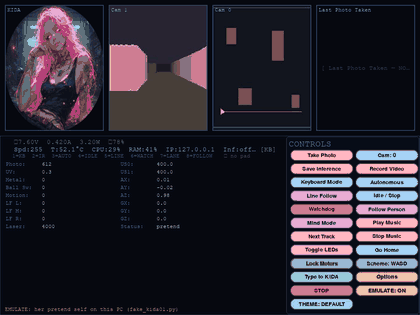
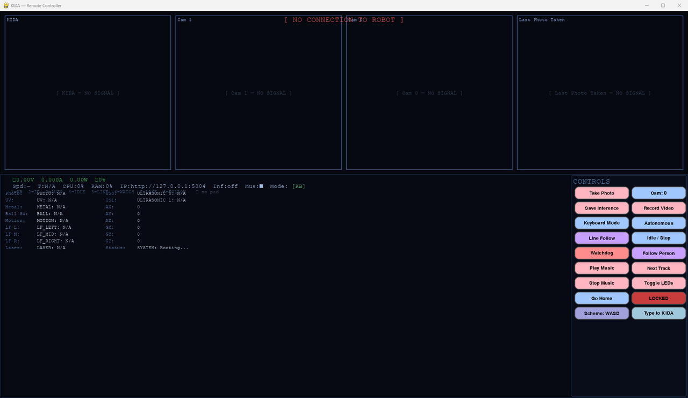
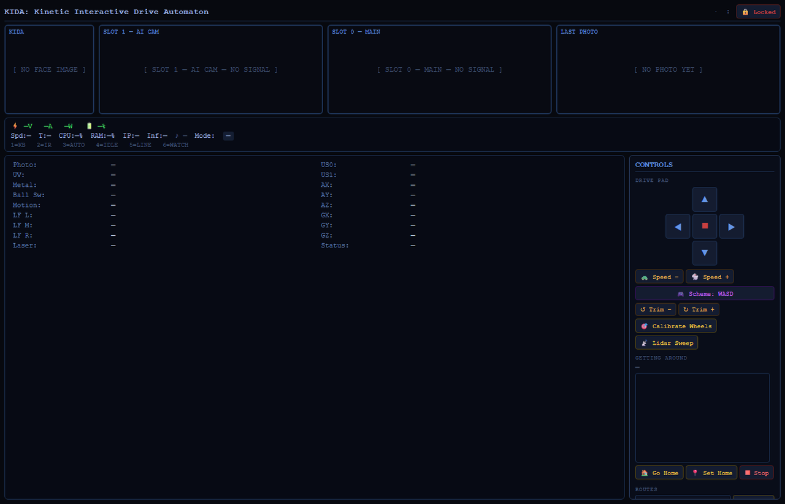

<p align="center"></p>

<h1 align="center">KIDA-01</h1>
<h3 align="center">Kinetic Interactive Drive Automaton</h3>
<p align="center"><i>A DREAM Robotics Agent</i></p>

<div align="center">

[](https://x.com/NorowaretaGemu) [](https://opensource.org/licenses/MIT)

</div>

<div align="center">
  <a href="https://ko-fi.com/cursedentertainment">
    
  </a>
</div>

<div align="center">
  
  
  
  
  
  
</div>

---

- Robot Type: Tank

<div align="center">
  
  <p><i>KIDA-01</i></p>
</div>

<div align="center">
  
</div>

---

<div align="center">
  
</div>

**Windows controller:** [`builds/KIDA-01-Controller.exe`](builds/KIDA-01-Controller.exe) shows KIDA-01's own web page in a window, so it always matches the page. Source: `scripts/web_controller`.

---

**Camera:** her Android app shows her camera (`/video_feed/0`).

**Other languages:** `scripts/controllers` has this robot's controller in C#, F#, Rust, Go and Julia, all reading one `robot.json`: W A S D to drive, the mode buttons and the sensors. See its README for how to run each.

## Related Projects


<table>
  <tr>
    <td align="center"><a href="https://github.com/CursedPrograms/ARIA-Robot-v00"><br>ARIA</a></td>
    <td align="center"><a href="https://github.com/CursedPrograms/KIDA-Robot-v00"><br>KIDA-00</a></td>
    <td align="center"><a href="https://github.com/CursedPrograms/WHIP-Robot-v00"><br>WHIP</a></td>
    <td align="center"><a href="https://github.com/CursedPrograms/NORA-Robot-v00"><br>NORA</a></td>
    <td align="center"><a href="https://github.com/CursedPrograms/MILA-Robot-v00"><br>MILA</a></td>
    <td align="center"><a href="https://github.com/CursedPrograms/NIKA-Robot-v00"><br>NIKA</a></td>
    <td align="center"><a href="https://github.com/CursedPrograms/IDA-Robot-v00"><br>IDA</a></td>
  </tr>
  <tr>
    <td align="center"><a href="https://github.com/CursedPrograms/ARM-Robot-v01"><br>ARM</a></td>
    <td align="center"><a href="https://github.com/CursedPrograms/DREAM"><br>DREAM</a></td>
    <td align="center"><a href="https://github.com/CursedPrograms/RIFT"><br>RIFT</a></td>
    <td align="center"><a href="https://github.com/CursedPrograms/RITA"><br>RITA</a></td>
    <td align="center"><a href="https://github.com/CursedPrograms/NINA"><br>NINA</a></td>
    <td align="center"><a href="https://github.com/CursedPrograms/TINA"><br>TINA</a></td>
  </tr>
</table>

---

## Overview

<details>
<summary><b>Overview</b></summary>

KIDA represents the pinnacle of the RIFT fleet. Built on the **Raspberry Pi 5**, it leverages the **Hailo-8L** AI accelerator to perform high-speed neural processing at the edge. With a dual-camera setup for multi-spectrum vision and local LLM integration, KIDA is designed for sophisticated human-robot interaction and autonomous decision-making without relying on the cloud.

Core Features
- [x] Neural Edge Processing: 13 TOPS of AI compute via Hailo-8L for real-time object detection and tracking.
- [x] Hybrid Dual-Vision: Simultaneous processing of Night Vision and 4K AI camera feeds for 24/7 situational awareness.
- [x] Local LLM Integration: Privacy-focused voice interaction and logic processing running entirely on-device.
- [x] Autonomous Navigation: Advanced SLAM and obstacle avoidance powered by high-speed Raspberry Pi 5 architecture.
- [x] Music Visualizer: while music plays, bars from the song itself rise along the bottom of her face on the HUD (`music_viz.py` + `audio_analysis.py`, KIDA-00's; they animate while a song is being read, or without pydub / ffmpeg).
- [x] Music Together: RIFT conducts and she plays along in time with the fleet: `POST /music {"action": "play", "track": 7, "at": <RIFT's time>}` on :5004, synced to RIFT's clock (`fleet_music.py`, the same contract as KIDA-00 and TINA). Tracks are numbered by the number in the file name, as on NORA's SD card.
- [x] Tip Stop: tilted more than 30° from her startup pose for a quarter second, in any mode, her motors stop, anything driving her by itself hands back to keyboard, and she says so; drive commands are refused until she's been level for a second (`scripts/tip_guard.py`, `tipped` in `/status`).
- [x] Two Screens: the full HUD (`ui.py`) on HDMI 0, the desktop screen, and a big-text status board (`small_screen.py`: her face, mode, wheel lock, battery, what she's doing) on a small touch screen in HDMI 1. They go by the physical port, so either works on its own; with only the small screen plugged in the HUD keeps running hidden. `config.json` `SmallScreen` (`Enabled`, `Port`).

</details>

---

<div align="center">
  
</div>

<details open>
<summary><b>🎮 Controls</b></summary>

Every key, gamepad button and IR remote button. The PC controller shows the same list with **F1**. One list feeds both: `controller/scripts/keymap.py` (regenerate with `python controller/scripts/keymap.py`).

<!-- KEYMAP:START (generated by controller/scripts/keymap.py) -->
**Modes (any time)**

| Key | Does |
| :--- | :--- |
| <kbd>1</kbd> | KEYBOARD: you drive |
| <kbd>2</kbd> | IR REMOTE: the IR remote drives |
| <kbd>3</kbd> | AUTONOMOUS: obstacle avoidance |
| <kbd>4</kbd> | IDLE: asleep, motors off |
| <kbd>5</kbd> | LINE FOLLOWER |
| <kbd>6</kbd> | WATCHDOG: person alarm |
| <kbd>7</kbd> | LANE DETECT (Hailo) |
| <kbd>8</kbd> | PERSON FOLLOW (cam 1) |
| <kbd>9</kbd> | MIND: an LLM drives her (this PC's, or her own: Options, Mind) |

**Drive (KEYBOARD mode)**

| Key | Does |
| :--- | :--- |
| <kbd>W A S D</kbd> | WASD scheme: forward, left, back, right; W+A etc. curve |
| <kbd>Q A / W S</kbd> | QAWS scheme: left track / right track, forward and back |
| <kbd>< or ,</kbd> | WASD scheme |
| <kbd>> or .</kbd> | QAWS (tank) scheme |
| <kbd>X</kbd> | next speed |
| <kbd>SPACE</kbd> | hard stop: motors and music |

**Camera, lights, music**

| Key | Does |
| :--- | :--- |
| <kbd>C</kbd> | photo |
| <kbd>V</kbd> | video |
| <kbd>I</kbd> | cam 0 inference (YOLO) on / off |
| <kbd>L</kbd> | lights on / off |
| <kbd>K</kbd> | light effects on / off |
| <kbd>M</kbd> | play music (skip when playing) |

**Robot**

| Key | Does |
| :--- | :--- |
| <kbd>U</kbd> | lock the motors / unlock (asks for the password) |
| <kbd>T</kbd> | type a message to her (PC controller) |
| <kbd>O</kbd> | her options: config.json (PC controller) |
| <kbd>H</kbd> | go home (PC controller) |
| <kbd>F1</kbd> | this keys window (PC controller) |
| <kbd>ESC</kbd> | close the window (on her: the UI restarts) |
| <kbd>Q</kbd> | quit (WASD scheme; on her: stops for good) |

**PC controller only**

| Key | Does |
| :--- | :--- |
| <kbd>Backspace</kbd> | STOP: motors off in any mode, back to KEYBOARD (as the STOP button) |
| <kbd>Drive keys, pad</kbd> | in any mode: driving takes over (back to KEYBOARD, you drive) |
| <kbd>STOP / EMULATE</kbd> | buttons: stop in any mode / her pretend self on this PC (fake_kida01.py) |

**Gamepad (on her or the PC)**

| Key | Does |
| :--- | :--- |
| <kbd>Left stick</kbd> | drive (WASD scheme) |
| <kbd>LT / RT</kbd> | left / right track, analog (QAWS scheme) |
| <kbd>LB / RB</kbd> | QAWS: that track backwards; WASD: previous / next mode |
| <kbd>Right stick</kbd> | aim the ultrasonic / laser servo |
| <kbd>A</kbd> | photo |
| <kbd>B</kbd> | stop |
| <kbd>X / Y</kbd> | speed down / up |
| <kbd>D-pad ← / →</kbd> | previous / next mode (set once you stop pressing) |
| <kbd>D-pad ↑</kbd> | video on / off (RT too, in the WASD scheme) |
| <kbd>Start</kbd> | lock the motors / unlock prompt |
| <kbd>Back</kbd> | LIDAR sweep |

**ARM's joystick (raw sticks)**

| Key | Does |
| :--- | :--- |
| <kbd>Stick</kbd> | drive |
| <kbd>Hat ← / →</kbd> | previous / next mode |
| <kbd>Hat ↑</kbd> | video on / off |
| <kbd>Trigger</kbd> | photo (as A) |
| <kbd>Button 1</kbd> | stop (as B) |
| <kbd>Button 2 / 3</kbd> | speed down / up (as X / Y) |

**IR remote**

| Key | Does |
| :--- | :--- |
| <kbd>1</kbd> | IR REMOTE mode |
| <kbd>2</kbd> | KEYBOARD mode |
| <kbd>3</kbd> | AUTONOMOUS |
| <kbd>4</kbd> | IDLE |
| <kbd>5</kbd> | LINE FOLLOWER |
| <kbd>6</kbd> | WATCHDOG |
| <kbd>↑ ↓ ← →</kbd> | drive (IR REMOTE mode); let go to stop |
| <kbd>Stop</kbd> | stop |
| <kbd>Play</kbd> | play music (skip when playing) |
| <kbd>Fast forward / Blue</kbd> | speed up |
| <kbd>Yellow</kbd> | speed down |
| <kbd>Skip</kbd> | switch between IR REMOTE and KEYBOARD |
| <kbd>Red / Green</kbd> | lock / unlock the motors (no password) |

<!-- KEYMAP:END -->

### HELLO, DANCE and THEME

Android app (`Android App/`, package `com.synthwomb`): FIND gets her address from the fleet list, or type it in. Hold the stick to drive, let go to stop, and HELLO, DANCE, photo, music and the wheel lock are buttons. Build it with `gradlew assembleDebug`.

**HELLO** and **DANCE** run on the spot in KEYBOARD mode through `/action`: the servo mount shakes, DANCE turns her left and right, a stop ends them and the wheel lock holds. **J** and **N** on the PC controller, buttons on her dashboard. The PC controller also has **THEME** (DEFAULT, LIGHT, CUSTOM); her own screen keeps its colours. `/status` carries `rev`, her settings in one number.

### Talking (in Brainfuck)
The robots talk in **Brainfuck**: every phrase is a Brainfuck program that prints its words (hello is `++++++++[>+++++++++++++<-]>.+.` → `hi`), and a robot says it by beeping the program on its buzzer, one tone per symbol, pitched to its own voice. The phrasebook (`talk_bf.h`) is generated by RIFT's `Fleet/brainfuck_talk.py`: phrases 0–6 (hello, how are you, happy, curious, sleepy, let's play, bye) and their replies 7–13. [RIFT](https://github.com/CursedPrograms/RIFT) runs the conversations between robots over WiFi and logs them on its dashboard; it asks KIDA to speak with `GET /chirp?u=<0-13>`. `server.py` passes it to the motor Arduino as `TALK:<u>`; she beeps it in a bright voice on the D8 buzzer, only while she's standing still (tone() shares Timer2 with the left motor's PWM). She registers `talk:5004` so RIFT can find her.

With another robot that has a mind (DREAM, KIDA-01, TINA - they register the `peer` capability), RIFT holds a **real conversation** when nobody is using them: rock paper scissors (both beep their move), then the winner picks words (spoken by the LLM) or Brainfuck (`peer_talk.py`, the same file in DREAM, KIDA-01 and TINA). In Brainfuck the chat opens with hello and only says goodbye at the end.

### Driven by NORA (fleet IR link)
[NORA](https://github.com/CursedPrograms/NORA-Robot-v00) can drive KIDA-01 through her IR transmitter, from her web page, Python controller or Bluetooth. The frames are Samsung-format IR at address `0x0DA4`, with the fleet link's commands: `0x48` forward, `0x49` back, `0x4A` left, `0x4B` right, `0x4C` stop, `0x4D` obstacle mode, `0x4E` manual, `0x4F` speed. The IR Arduino (`arduino01`) prints each command as the IR line the Pi already reads (`IRforward`, `IRrelease`, `IR3`…), so nothing on the Pi changed. Driving switches her into IR Remote mode; she stops once the link has been quiet for 500 ms.

</details>

> [!TIP]
> Use **Mode 2** for heavy terrain or precise pivoting, and **Mode 1** for smooth, cinematic strafing.

---

<div align="center">
  
</div>

</details>

---

## 🧠 Inner Life (`scripts/kida_mind`)

KIDA has the same inner life as DREAM (ported from DREAM's `dream_mind`, minus the libido drive and dreaming — dreams would cost the Pi too much), adapted to a robot body. It's optional — if it can't load, KIDA runs exactly as before.

* **Mood & needs** — mood (valence/arousal plus a wandering good-day/bad-day temperament) and needs: loneliness, curiosity, feeling on edge, and sleep pressure with a body clock.
* **Memory** — every conversation becomes an episode in a memory graph; recall is associative and mood-coloured, memories fade unless they matter, and sleep strengthens the important ones. Facts (your name, pet, home, job, birthday) are remembered too.
* **Her body** — bumps, nearly tipping over, rough rides and being driven around all reach her mood; so do her battery (INA219) and her Pi's load and temperature. She'll say "ow" when she hits something.
* **Eyes** — about once a minute she glances through cam-1 (who's there comes from the IMX500); after a drive the first glance is "somewhere new". No pictures are saved — just what she noticed.
* **Sleep** — after a quiet spell (sooner when she's tired) she dozes off in IDLE mode and tidies her memories once (important ones strengthen, trivial ones fade). No dreaming, so sleep costs the Pi nothing. Her name, typed text, driving her or a mode change wakes her.
* **Initiative** — she sometimes speaks first (a reminder, a question, missing you, a bump), with impulse control: never at 3 am, not into an empty room, less if you ignore her.
* **Boundaries & care** — she won't pretend to be human, says when something stings, and drops everything for anyone who sounds like they're in danger. Stop/lock/quit/forget commands are always honoured.
* **Your control** — "forget that", "forget about X", "forget everything" (confirmed), "stop talking on your own", "watch my face" (off by default). Everything lives in `memories/` on the Pi and is gitignored.

The web dashboard shows a **Mind** panel (`/mind`); the Pi HUD shows her mood next to the gamepad indicator.
Self-test (fake LLM, scratch folder — never touches her real memories): `cd scripts && python -m kida_mind.selftest`

## 🧠 MIND mode (mode 9): an LLM drives her

The fleet's MIND mode (`scripts/kida_drive_mind.py`, `scripts/mind.py`, the same file as in NORA's, WHIP's, MILA's, NIKA's and ARM's controllers): she stands still, her mind looks at what she senses, thinks out loud, says something in her own voice, makes one short move, and remembers it. She's warm, nosy and chatty, and narrates what she finds like a nature documentary.

**Where her mind runs** is an option: `config.json` `Mind` `Where`:

| `Where` | Who drives her |
|---|---|
| `auto` (default) | Her PC controller when one that can think is connected (x86, 8 GB+ RAM, GTX 1050 or better; `mind.can_think()`), with its bigger model (qwen3 sized to the GPU) and both cameras through its vision model. With no PC, **her own Pi** does, with `SelfModel` on her own Ollama. A PC that connects takes over; if it goes quiet she carries on herself. |
| `pc` | Only a PC, like the rest of the fleet. No PC, no MIND mode. |
| `self` | Always her own Pi, even with a PC connected. |
| `off` | No MIND mode. |

`SelfModel` (`qwen2.5:0.5b`, the model her voice chat uses: small, so her own mind is simple), `SelfThink` (false; only qwen3-type models think) and `Goal` (what she's told to do) are there too.

- **Starting it:** key **9** (on her or the PC controller), the **Mind Mode** button, or **🧠 Mind** in the web dashboard's mode list (shown only while a mind can drive her). Any other mode ends it.
- **Thinking stays visible:** her own mind's thoughts show in her HUD's mind panel, the web dashboard (under Mode) and the PC controller; the PC's mind shows in the PC controller.
- **Her body's reflexes stay on:** she won't drive forward into anything within 20 cm, a bump stops her, and the **motor lock** stops her completely. Signing in as her mind host doesn't unlock her motors (that's still U / the button / the IR remote).
- She speaks with Piper when her own mind talks, and with the PC's Zira voice (a WAV played on her speaker, `POST /speak`) when the PC's does.
- The fleet's contract: `/unlock?pw=&ctl=1`, `/status?ctl=1` (adds `mindHost`, `mindSteps`, `blocked`, `mindBrain`), `/mode?m=mind`, `/mind?act=fwd|bwd|left|right|stop&steps=1-4`.

## ⚙️ Options

Her `config.json` (cameras, small screen, MIND mode, ...) can be changed three ways, all the same settings:
- **On her:** `python options.py` (or `options.bat` on Windows), the game-style menu every DREAM robot has.
- **Her web page:** `http://<her-ip>:5004/options` (the **⚙ Options** link on the dashboard). Save with her PIN.
- **The PC controller:** **O** or the **Options** button opens the same menu on the PC with her config; when you close it, she asks for her PIN and saves it.

Saving keeps the old file as `config.json.bak`. Most settings take effect when she restarts. The PIN is a safety catch, not security.

### Knowing people, getting around, and her day

* **Faces** (`face_id.py`) — tell her your name ("my name is Sam"), then say **"remember my face"** and look at cam-1 for ~10 s ("remember this face as Alex" for someone else). She greets people she knows by name, asks strangers who they are, and knows who she's talking to. Only face fingerprints are stored (`memories/faces.json`), never pictures; "forget my face" removes them. One-time model download: `cd scripts && python3 face_id.py --download`.
* **Where she is** (`odometry.py`) — no wheel encoders, so dead reckoning: distance from the motor commands, heading from the MPU6050 gyro. Set `CM_PER_S_AT_FULL` once (drive 3 s at speed 255, measure). LIDAR sweeps are now stamped with her pose, so maps from different spots line up.
* **Go home** — "go home" / 🏠 / `H` on the controllers drives back to where she started (or where you said "this is home"). Stops for obstacles and bumps, and hands straight back to you the moment you touch a control.
* **Routes** (`routes.py`) — "record a route called kitchen", drive it, "save the route". Then "run the kitchen route", or "patrol kitchen" (there and back until you say "stop patrolling"). She remembers what each stop looked like and tells you if something's changed ("near the second stop, there's something in the way now"). Start a replay where you started recording, facing the same way.
* **Person follow** now goes *around* things between you and her: she looks left and right with the servo sensor and detours toward the side with more room.
* **Today** (`daylog.py`) — how far she drove, who she saw, bumps, her mood through the day, conversations and photos, summarised on the web page (with a mood strip, and past days); after 9 pm it goes into her journal.
* **Mind on the controllers** — both PC controllers and the Pi HUD show her mood, needs, latest thought and the last exchange; press **T** (or "Type to KIDA") to talk to her from the PC.

---

## Prerequisites

<details>
<summary><b>Prerequisites</b></summary>

### Software
- [Arduino IDE](https://docs.arduino.cc/software/ide/)
- [Raspberry Pi OS](https://www.raspberrypi.com/software/operating-systems/)
### Operating System
- **Recommended:** Raspberry Pi OS (Bookworm)
- **Kernel:** `6.12.62+rpt-rpi-2712`

---

## Hardware

### Compute
| **Component** | **Details** |
|-----------|---------|
| Main Board | Raspberry Pi 5 (4GB) |
| PCI-E Board | NVMe + AI Hat |
| AI Accelerator | Hailo-8 (13 TOPS) via NVMe + AI Hat |
| Storage | NVMe SSD |
| I2C | Custom |

### Microcontrollers
| **Component** | **Details** |
|-----------|---------|
| Microcontroller 0 | RGBduino Jenny | Dev0 |
| Microcontroller 1 | Arduino UNO | Dev1 |

### Chassis & Motion
| **Component** | **Details** |
|-----------|---------|
| Chassis | Robot Tank Chassis |
| Motor Driver | L298N |
| Motors | 2× 12v DC Motors |

### User Controllers
| **Component** | **Details** |
|-----------|---------|
| Interface | PC, Android, iPhone |
| Controller | Wireless Keyboard, IR remote |
| Screens | Desktop screen on HDMI 0 (the HUD), small touch screen on HDMI 1 (`small_screen.py`) |

### Power System
| **Component** | **Details** |
|-----------|---------|
| Motor Battery | 3s 21700 (12.6V in series) |
| Compute Battery | 3s 18650 via Pi UPS |
| Realtime Battery | CR2032 |
| Voltage Regulator | LM2596S (12V → 11.5V) |
| Power Switches | 4× (Main + UPS), 2× MOSFET SWITCHES|

### Cameras
Two fixed front cameras, either side of her centreline, 8 cm apart lens to lens. Their views overlap in the centre, so what's straight ahead is in both (person-follow mode triangulates its distance from that).

| **Camera** | **Type** | **Side** (facing forward with her) | **Pi 5 port** | **Horizontal FOV** | **Runs** |
|---|---|---|---|---|---|
| Cam 0 | Raspberry Pi Night Vision Camera (NoIR) | **Left** | **CAM/DISP 0** (`Picamera2(camera_num=0)`) | 62.2° | YOLO on the Hailo-8L |
| Cam 1 | Raspberry Pi AI Camera (IMX500) | **Right** | **CAM/DISP 1** (the IMX500 library finds it) | 66.3° | its on-chip detector, always on |

This is how she's wired today, and it's the default in `config.json` `Cameras` (`scripts/kida_config.py` reads it): `NightCamPort` 0, `NightCamSide` "left" (the AI camera is the other side), `NightCamHFovDeg` 62.2, `AICamHFovDeg` 66.3, `BaselineCm` 8.0, `InvertSteer` false. Change them in her options (below) if you move a camera; she uses them after a restart.

### Sensors
| **Component** | **Details** |
|-----------|---------|
| Ultrasonic Sensors | HC-SR04 × 2 (one mounted on servo for scanning) |
| Line Follower | 3-Channel Line Tracking Sensor |
| Switch Sensor | Ball Switch (Impact Detection) |
| Infrared | IR Receiver Module |
| UV Sensor | UV Light Sensor Module |
| Light Sensor | Photoresistor (LDR) |
| ToF Sensor | Time-of-Flight Laser Distance Sensor |
| PIR Sensor | Passive Infrared Motion Sensor |

### Audio
| **Component** | **Details** |
|-----------|---------|
| Output | Pi Speakers |
| Input | USB Microphone |

</details>

---

<div align="center">
  
</div>
<br>

# Schematics
## ⚡ Technical Pinouts

> [!CAUTION]
> **Ground Loop Warning:** All modules must share a common GND. Failure to bridge grounds will cause erratic motor behavior and sensor noise.

> [!WARNING]
> **Buzzer and left motor share a timer on DEV0.** `tone()` on the buzzer (D8) uses Timer2, which also drives PWM on D3, the left motor's speed pin. While a beep plays, the left track's speed is disturbed. Fix it by swapping two wires and the matching constants in `arduino00.ino`: **left PWM ↔ left DIR2** (`MOTOR_LEFT_PWM` → 5, `MOTOR_LEFT_DIR2` → 3). Pin 5 is Timer0 PWM, like the right motor's pin 6.

<details>
<summary><b>Power Distribution Wiring</b></summary>

### Power Schematic
```
3S 21700 BATTERIES ──────► LM2596S INPUT 11.5V ──────► LM2596S Output 11.5V
LM2596S Output 11.5V:
├── + ──────► L298N +
├── – ──────► L298N - ─────────► ARDUINO (DEV0) GND
├── + ──────► MOSFET switch ─────────► (12V) FRONT LIGHTS +
├── + ──────► MOSFET switch ─────────► (12V)BACK LIGHTS +
├── – ──────► MOSFET switch ─────────► FRONT LIGHTS -
└── – ──────► MOSFET switch ─────────► BACK LIGHTS -  
```
```
3S 18650 BATTERY UPS ──────► USB-C OUTPUT ──────► RASPBERRY PI
    ├──► POWER BUTTON
    └──► CHARGING PORT
```
```

UPS:
├── I2C ─────► Raspberry Pi I2C BUS
├── 3.3V ────► BREADBOARD (3.3V rail)
├── 5V ──────► SERVO POWER
└── 5V ──────► BREADBOARD (5V rail)
```
</details>

<details>
<summary><b>Raspberry Pi Wiring</b></summary>

```
RASPBERRY PI:
├──► NVMe + AI HAT (PCIe)
│     └──► NVMe SSD + HAILO-8L
│
├──► ARDUINO (DEV0, DEV1) via USB
├──► Camera 0 ─────► Night Vision Camera
├──► Camera 1 ─────► AI Camera (IMX500)
├──► SPEAKER HAT (USB)
│
├──► USB HUB:
│     ├── MIC (USB)
│     └── WIRELESS KEYBOARD (USB)
│
└──► GPIO:
      └──► I2C BUS
            ├── SDA → Pin 3
            └── SCL → Pin 5
```
</details>

<details>
<summary><b>Arduino (DEV0) Wiring</b></summary>

### **ARDUINO (DEV0):**
#### Libraries:
```
Adafruit_VL53L0X.h
Servo.h
Adafruit_NeoPixel.h
avr/power.h
Wire.h
```
```
POWER:
├── 5V ──────► From Raspberry Pi (USB)
└── GND ─────► Common GND (L298N, USB, modules)

INPUT / OUTPUT:
├── D2  ─────► BUTTON
├── D8  ─────► BUZZER

SERVO:
├── D10 ─────► SERVO SIGNAL
├── 5V  ─────► SERVO VCC (external 5V from UPS)
└── GND ─────► SERVO GND

ULTRASONIC SENSORS:
├── US0 (FIXED)
│   ├── A1 ─────► TRIG
│   └── A0 ─────► ECHO
│
└── US1 (SERVO-MOUNTED)
    ├── A2 ─────► TRIG
    └── A3 ─────► ECHO

MOTOR DRIVER (L298N):
├── D6  ─────► RIGHT MOTOR PWM
├── D7  ─────► RIGHT DIR1
├── D9  ─────► RIGHT DIR2
│
├── D3  ─────► LEFT MOTOR PWM
├── D4  ─────► LEFT DIR1
└── D5  ─────► LEFT DIR2

LED STRIPS (NEOPIXEL):
├── D13 ─────► STRIP 1 DATA
└── D12 ─────► STRIP 2 DATA

VL53L0X:
├── VCC ─────► 5V
├── GND ─────► GND
├── SDA ─────► A4
└── SCL ─────► A5
```

</details>

<details>
<summary><b>Arduino (DEV1) Wiring</b></summary>

### **ARDUINO (DEV1):**
#### Libraries:
```
IRremote.h
```
```
POWER:
├── 5V ──────► From Raspberry Pi (USB)
└── GND ─────► Common GND (USB, modules)

IR REMOTE:
├── D5 ──────► IR RECEIVER SIGNAL
├── 5V ──────► IR RECEIVER VCC
└── GND ─────► IR RECEIVER GND

LIGHTS:
├── D2 ──────► FRONT LIGHT (+ via MOSFET)
└── D3 ──────► BACK LIGHT (+ via MOSFET)

SENSORS (ANALOG):
├── A0 ──────► METAL SENSOR
├── A1 ──────► PHOTORESISTOR (LIGHT SENSOR)
├── A2 ──────► UV SENSOR
└── A3 ──────► BALL SWITCH (digital read but on analog pin)

SENSORS (DIGITAL):
├── D4  ─────► PIR MOTION SENSOR
├── D8  ─────► LINE FOLLOWER LEFT
├── D10 ─────► LINE FOLLOWER MID
└── D9  ─────► LINE FOLLOWER RIGHT
```

</details>

> [!TIP]
> **Pro-Tip:** Make sure all modules share a common ground (GND) for stable operation.

---
## 🌐 Connectivity & Controls

<details>
<summary><b>Connectivity & Controls</b></summary>

### Network Configuration
| Parameter | Value |
| :--- | :--- |
| **SSID** | `NORA` |
| **Password** | `12345678` |

### PC controller

`controller/run.bat <her-ip>` (or `run.ps1`; `run.sh` after `setup_venv.sh`): her own HUD on another PC, plus the PC's own:

- **EMULATE** (a button): her pretend self on this PC (`controller/fake_kida01.py`: her Flask routes on `127.0.0.1:5004`, both cameras, her inner life, MIND), in a room to drive round, so every key and button can be tried with no robot. With no IP given, the controller starts on it.
- **STOP** (a button, or Backspace): motors off in any mode, back to KEYBOARD.
- **Driving takes over**: a drive key or the pad while she drives herself (AUTONOMOUS, LINE, FOLLOW, MIND...) puts her back in KEYBOARD, so letting go stops her.
- **Settings stick**: a mode, the drive scheme or the music is sent again until her `/status` says so.
- **Session test**: `controller/venv/Scripts/python controller/session_test.py` drives the controller on her pretend self like a person and checks every response.
- No THEME yet: her HUD's colours are written into `scripts/hud_draw.py`, which her own screen shares.

### RIFT Integration
To connect via [RIFT](https://github.com/CursedPrograms/RIFT), ensure KIDA01 is active on:
* `localhost:5004`

</details>

---

## Setup:

### MX500 AI Camera

<details>
<summary><b>MX500 AI Camera Setup</b></summary>

```bash
sudo apt update && sudo apt full-upgrade
```
```bash
sudo apt install imx500-models
```
```bash
rpicam-hello --list-cameras
```
#### AI Camera Object Detection (Realtime)
```bash
rpicam-hello --camera 1 -t 0 \
  --post-process-file /usr/share/rpi-camera-assets/imx500_mobilenet_ssd.json \
  --viewfinder-width 1920 \
  --viewfinder-height 1080 \
  --framerate 30
```
#### AI Camera Object Detection (Video)
```bash
rpicam-vid --camera 1 -t 10s -o output.264 
--post-process-file /usr/share/rpi-camera-assets/imx500_mobilenet_ssd.json 
--width 1920 
--height 1080 
--framerate 30
```

#### AI Camera Pose Estimation (Realtime)

```bash
rpicam-hello --camera 1 -t 0s 
--post-process-file /usr/share/rpi-camera-assets/imx500_posenet.json 
--viewfinder-width 1920 
--viewfinder-height 1080 
--framerate 30
```
#### Picamera2

```bash
sudo apt install python3-picamera2 --no-install-recommends
```

```bash
sudo apt install python3-opencv python3-munkres
```
```bash
python imx500_object_detection_demo.py --model /usr/share/imx500-models/imx500_network_ssd_mobilenetv2_fpnlite_320x320_pp.rpk
```
```bash
python imx500_pose_estimation_higherhrnet_demo.py
```

#### Documentation
https://www.raspberrypi.com/documentation/accessories/ai-camera.html
https://github.com/raspberrypi/picamera2/tree/main/examples/imx500

</details>

---
### Install Ollama

<details>
<summary><b>Ollama Setup</b></summary>

```bash
sudo snap install ollama
ollama --version
```

#### Pull Ollama Model

```bash
ollama pull gemma3:4b-it-qat
```
#### Run Ollama Model
```bash
ollama run deepseek-r1:1.5b
```

</details>

---
### Environment Setup

<details>
<summary><b>Environment Setup</b></summary>

```bash
sudo apt update
sudo apt install python3-venv python3-pip

python3 -m venv ~/kida-venv
source ~/kida-venv/bin/activate

pip install --upgrade pip
pip install -r requirements.txt
```

</details>

---
### Install OpenAI Whisper

<details>
<summary><b>Whisper Setup</b></summary>

```bash
pip install git+https://github.com/openai/whisper.git
```

```bash
python3 -c "import whisper; whisper.load_model('large')"
python3 -c "import whisper; whisper.load_model('tiny')"
```

</details>

---
### Install Audio Dependencies

<details>
<summary><b>Audio Setup</b></summary>

```bash
sudo apt install ffmpeg alsa-utils -y pulseaudio jackd2 alsa-utils portaudio19-dev python3-pyaudio
```

</details>

---
### Install Piper TTS

<details>
<summary><b>Piper Setup</b></summary>

```bash
pip install piper-tts
```
#### Download Voices

```bash
mkdir -p ~/voices/

# Amy (medium) — recommended
wget "https://huggingface.co/rhasspy/piper-voices/resolve/v1.0.0/en/en_US/amy/medium/en_US-amy-medium.onnx?download=true" -O en_US-amy-medium.onnx
wget "https://huggingface.co/rhasspy/piper-voices/resolve/v1.0.0/en/en_US/amy/medium/en_US-amy-medium.onnx.json?download=true" -O en_US-amy-medium.onnx.json
``` 

#### Test Piper

```bash
echo "Hello, I am your voice assistant." | \
piper --model voices/en_US-amy-medium.onnx \
--output_raw | aplay -D plughw:2,0 -r 22050 -f S16_LE -t raw -
```

#### Install Piper binary (Not Needed)

```bash
wget https://github.com/rhasspy/piper/releases/download/2023.11.14-2/piper_linux_x86_64.tar.gz
tar xzf piper_linux_x86_64.tar.gz
sudo mv piper/piper /usr/local/bin/
```

</details>

### Install & Set Up Hailo

<details>
<summary><b>Hailo8l Setup</b></summary>

```bash
sudo apt update
sudo apt install hailo-all
```
### Test Hailo
- Verify the installation:
```bash
hailortcli fw-control identify
```
- Expected output:
```
Device: Hailo-8l
PCIe Address: 0001:03:00.0
Firmware Version: x.x.x
```

**Troubleshooting:** 
- If the driver is not detected after install, a DKMS module may have failed to build. Pin back to version 4.19 which has stable kernel module support:
```bash
sudo apt-mark hold linux-image-rpi-2712 linux-headers-rpi-2712
sudo apt install hailort=4.19.0 hailo-all=4.19.0 -y
sudo apt-mark hold hailort hailo-all
sudo reboot
```

#### Manual Hailo Build (if package unavailable)
```bash
sudo apt install -y git build-essential cmake python3-dev python3-pip

git clone https://github.com/hailo-ai/hailort.git
cd hailort && mkdir build && cd build
cmake .. && make -j$(nproc) && sudo make install

echo "export LD_LIBRARY_PATH=/usr/local/lib:$LD_LIBRARY_PATH" >> ~/.bashrc
source ~/.bashrc
pip install hailort
```
</details>

#### Diagnostics

<details>
<summary><b>Diagnostics</b></summary>

```bash
# Check Hailo kernel module
lsmod | grep hailo

# Identify Hailo device
hailortcli fw-control identify

# Check PCI devices
lspci | grep Hailo

# Kill conflicting camera processes
ps aux | grep -E 'libcamera|picamera'
sudo kill -9 <PID>

# Check which process is using the camera
sudo fuser -v /dev/video0

# Kernel version
uname -r
```

</details>

---

### RTC Setup

<details>
<summary><b>RTC Setup</b></summary>

```bash
dtparam=rtc_bbat_vchg=3000000
sudo mount -o remount,rw /boot/firmware
sudo nano /boot/firmware/config.txt
sudo hwclock -w
sudo hwclock -v -r
```

</details>

---

<details>
<summary><b>PCIE3 Setup</b></summary>

Enable PCIe Gen 3 speeds for the Hailo Hat
 - dtparam=pciex1_gen=3

```bash
/boot/firmware/config.txt
```

</details>

---

```bash

apt-get update
apt-get install -y libsm6 libxext6 libxrender-dev
pip install opencv-contrib-python
pip install opencv_transforms
pip install opencv-python
pip install facenet-pytorch
pip install piper-tts
pip install git+https://github.com/openai/whisper.git
sudo apt install pulseaudio jackd2 alsa-utils portaudio19-dev python3-pyaudio imx500-models

https://download.pytorch.org/whl/cpu/torch-1.0.1.post2-cp36-cp36m-linux_x86_64.whl
https://download.pytorch.org/whl/cpu/torch-1.0.1.post2-cp37-cp37m-linux_x86_64.whl

```

---

#### InceptionResnetV1

```bash
from facenet_pytorch import InceptionResnetV1

# For a model pretrained on VGGFace2
model = InceptionResnetV1(pretrained='vggface2').eval()

# For a model pretrained on CASIA-Webface
model = InceptionResnetV1(pretrained='casia-webface').eval()

# For an untrained model with 100 classes
model = InceptionResnetV1(num_classes=100).eval()

# For an untrained 1001-class classifier
model = InceptionResnetV1(classify=True, num_classes=1001).eval()
```

#### Pre-processing
```bash
# Basic debugging
from opencv_transforms.debug import utils
result = utils.compare_contrast_outputs(image, contrast_factor=0.5)

# Create test summary across multiple contrast factors
summary = utils.create_contrast_test_summary(image)

# Analyze PIL precision issues
utils.analyze_pil_precision_issue(image)
```
#### Detection Pipeline

```bash

from facenet_pytorch import MTCNN, InceptionResnetV1

# If required, create a face detection pipeline using MTCNN:
mtcnn = MTCNN(image_size=<image_size>, margin=<margin>)

# Create an inception resnet (in eval mode):
resnet = InceptionResnetV1(pretrained='vggface2').eval()

apt-get update
apt-get install -y libsm6 libxext6 libxrender-dev
pip install opencv-python
```
---
## Running KIDA

### Activate the virtual environment
```bash
cd /home/kida-01/Desktop/Kida-Robot
source venv/bin/activate
```

### Run the main script
```bash
python scripts/main.py
```
---

### Autostart on Boot

<details>
<summary><b>Autostart on Boot Setup</b></summary>

#### Option A: systemd service (recommended)

One script sets it up (or replaces an older hand-made `kida.service`):

```bash
sudo ./install_service.sh               # install, enable at boot, start now
sudo ./install_service.sh --uninstall   # stop and remove
```

It runs `run.sh` as your user once the desktop is up (her HUD needs the screen), with the groups she
needs (GPIO, camera, audio, I2C/SPI, `dialout` for the Arduino), lets her fleet WiFi ladder change the
WiFi (`ladder_setup.sh`), and restarts her if she crashes, but not when you quit with **Q**. Turn on
desktop auto-login first (`sudo raspi-config` → System Options → Boot / Auto Login → Desktop Autologin),
and reboot once after the first install.

```bash
sudo systemctl status kida      # running?
journalctl -u kida -f           # live log (also logs/kida_run.log)
sudo systemctl stop kida        # free the camera / GPIO to run things by hand
```
---
#### Option B: Camera preview service

Not together with Option A: both want the camera.

```bash
sudo nano /etc/systemd/system/kida-camera.service
```

```ini
[Unit]
Description=KIDA Camera Live Preview
After=graphical.target

[Service]
User=kida-01
Environment=DISPLAY=:0
ExecStart=/usr/bin/python3 /home/kida-01/Desktop/Kida-Robot/scripts/camera_preview.py
Restart=always
RestartSec=5

[Install]
WantedBy=graphical.target
```

```bash
sudo systemctl daemon-reload
sudo systemctl enable kida-camera.service
sudo systemctl start kida-camera.service
```

Check status / logs:
```bash
sudo systemctl status kida-camera.service
journalctl -u kida-camera.service -f
```
---
#### Option C: crontab

```bash
crontab -e
# Add:
@reboot cd /home/kida-01/Desktop/Kida-Robot && python3 main.py &
```
---
#### Option D: Desktop autostart

```bash
mkdir -p ~/.config/autostart
nano ~/.config/autostart/kida.desktop
```

```ini
[Desktop Entry]
Name=KIDA Controller
Exec=python3 /home/kida-01/Desktop/Kida-Robot/main.py
Type=Application
X-GNOME-Autostart-enabled=true
```

</details>

---

<div align="center">
  
</div>
<br>
<br>
<div align="center">
  
</div>
## 📡 Who's nearby (ESP-NOW + Bluetooth LE)

Every robot sends a small **"I'm here"** beacon twice a second and listens for the others'. From the **signal strength** it knows roughly how close each one is, and from how that changes over time whether it's **coming closer, steady or leaving**:

| Signal | Zone |
| :--- | :--- |
| above −45 dBm | very close |
| −45 to −60 dBm | near |
| −60 to −75 dBm | medium |
| below −75 dBm | far |

It's coarse (walls, bodies and antenna angle all change it): for "who's around", not distance. Precise collision avoidance stays with the ultrasonic and ToF sensors.

**They tell each other what they're doing**, because a rising signal looks the same from both sides even when only one robot moves. Over ESP-NOW they say it **in Brainfuck**, like the fleet's conversations: each beacon carries a program that prints `park`, `go`, `wait` or `hand` (a human is driving), and the receiver runs it. Bluetooth adverts are too small for a program, so BLE carries the same state as one byte.

**Who makes way**, in self-driving modes only:

| The other robot... | So this one... |
| :--- | :--- |
| is parked | is the one closing in: steers away |
| is yielding | carries on, carefully |
| is driven by a human | makes way (it's unpredictable) |
| drives itself | follows the alphabet: KIDA00, KIDA01, NORA, WHIP; everyone makes way for MILA, who can't hear the others |
| is leaving | carries on |

Making way = stop for 2 s, turn away, then drive on (and not yield again for 5 s, so two robots that stay close don't take turns forever). While another robot is near, or coming closer, it drives slower with wider margins.

A Pi can't speak ESP-NOW, so KIDA-01 uses the Pi's own **Bluetooth LE**: she beacons through `bluetoothctl` and listens with `bleak`, hearing NORA, WHIP, KIDA-00 and RIFT. In **autonomous** mode her Arduino drives, so `scripts/fleet_guard.py` steps in to give way (AUTO_OFF + STOP, LEFT, then AUTO_ON) and drops her to 60 % of your speed while a robot is near. `GET /near` shows her list. Code: `scripts/fleet_near.py`, `scripts/fleet_guard.py`.

---

## Screenshots

<div align="center">
  
  
</div>

<p align="center"><i>Remote controller, Web dashboard. Captured without a robot connected, so live values show their offline state.</i></p>

---

<div align="center">&copy; Cursed Entertainment 2026</div>

<div align="center">
  <a href="https://cursed-entertainment.itch.io/">
    
  </a>
</div>

<div align="center">
  <a href="https://github.com/SynthWomb">
    
  </a>
</div>

---

<!-- DREAM-ECOSYSTEM:START -->
## The DREAM Robotics ecosystem

**Minds** — [DREAM](https://github.com/CursedPrograms/DREAM) companion · [TINA](https://github.com/CursedPrograms/TINA) engineer · [NINA](https://github.com/CursedPrograms/NINA) caretaker · [RIFT](https://github.com/CursedPrograms/RIFT) fleet hub · [LYCEA](https://github.com/CursedPrograms/LYCEA) training school  
**Robots** — [NORA](https://github.com/CursedPrograms/NORA-Robot-v00) · [MILA](https://github.com/CursedPrograms/MILA-Robot-v00) · [WHIP](https://github.com/CursedPrograms/WHIP-Robot-v00) · [KIDA-00](https://github.com/CursedPrograms/KIDA-Robot-v00) · [KIDA-01](https://github.com/CursedPrograms/KIDA-Robot-v01) · [IDA](https://github.com/CursedPrograms/IDA-Robot-v00) · [ARM](https://github.com/CursedPrograms/ARM-Robot-v01) · [NIKA](https://github.com/CursedPrograms/NIKA-Robot-v00) · [ARIA](https://github.com/CursedPrograms/ARIA-Robot-v00)  
**Remotes** — [RITA](https://github.com/CursedPrograms/RITA) handheld remote  
<!-- DREAM-ECOSYSTEM:END -->
